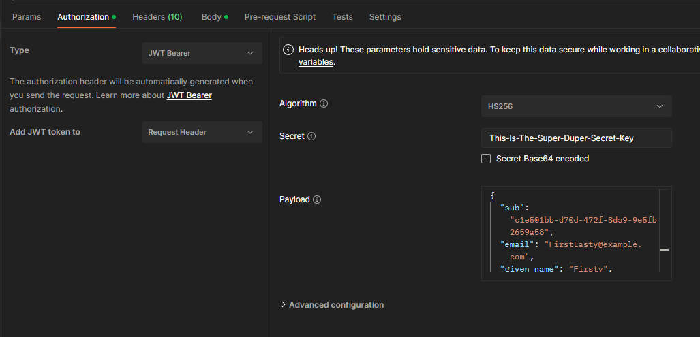

# Consilium Tempus Backend API

To use the application and access its API endpoints, you will need a valid JWT token 
to be authenticated and get authorization.

* [Api Controller](#api-controller)
* [Authentication](#authentication)
* [Authorization](#authorization)
* [Conventions](#conventions)
  * [Host and Prefix](#host-and-prefix)
  * [Identifiers](#identifiers)
  * [Responses](#responses)
  * [Errors](#errors)
  * [Search, Order and Pagination](#search-order-and-pagination)
* [Controllers](#controllers)

## Api Controller

Inside the code you will find an Api Controller **class**, under the _Controllers_ package. 
This class implements basic functionality for all the controllers that are and will be created in the project. 
It is intended to be extended by all the controllers (Template Design Pattern).

The template Api Controller resolves the following:
- it sets the RESTful Api route to `[controller]s` to sub controllers, 
where **controller** is the name of the controller 
(i.e., for a User Controller the route would be `{{host}}/api/users`, **notice** the api prefix,
which is the path base set)
- it seeks authentication via a token by default (see below for a valid token),
otherwise the user should make use of the *Allow Anonymous* attribute
- it injects the mapper and the mediator
- it contains a solution for returning validation problems, conflicts, etc.

## Authentication

The developer shall provide a token for endpoints that do not allow anonymous requests.
One way to add one inside Postman is to go to the *Authorization* tab and under the type *JWT Bearer* add the following:
- **Secret Key**, defined in the [Get Started](../README.md#dotnet-user-secrets) chapter 
- and **Payload** which should include the following:
  - **sub**, the user id of an existing user
  - **email** of the user
  - **jti**, the id of the token
  - **exp**, the expiration date in seconds
  - **iss** (Issuer) of the application (can be found in the Jwt Settings inside the `appsettings.json`)
  - **aud** (Audience) of the application (can be found in the Jwt Settings inside the `appsettings.json`)

**NOTICE**: The claims are case-sensitive, therefore, they should match with the database data 
(except for **sub** and **jti**).

An example can be found below: 
(for a better view of the payload check the Api Auth [documentation](api/Api.Auth.md#auth))



## Authorization

To add authorization for each endpoint, 
use the **Has Permission** Attribute in combination with the **Permissions** Enum from the [Domain](Domain.md#enums).
Also, the **Has Project Authorization** and **Has Workspace Authorization** attributes can be used
in combination with the authorization levels from the same chapter.

## Conventions

These are the conventions shared by all the endpoints documented in the [Controllers](#controllers) section.
The constraints of the properties of each request (i.e., maximum lengths) are described in the
[Domain Models](Domain.md) documentation.

### Host and Prefix

`{{host}}` stands for the address where the application runs, without the path base, i.e., `http://localhost:7123`
(see the [Test Development Environment](../README.md#test-development-environment)).
All the routes start with the `api` prefix, so a full route looks like `{{host}}/api/users`.

### Identifiers

The identifiers (i.e., **id** or **workspaceId**) are GUIDs, like `10000000-0000-0000-0000-000000000000`.

### Responses

The endpoints that read data respond with the data itself, as shown in the documentation of each endpoint.

The ones that just perform an operation (i.e., create, update or delete) usually respond with a confirmation message:

```json
{
  "message": "Workspace has been created successfully!"
}
```

### Errors

Errors are returned in the *Problem Details* format (RFC 7807).
The status code depends on the type of the error:

| Error type   | Status code |
|--------------|:-----------:|
| Validation   |     400     |
| Unauthorized |     401     |
| Forbidden    |     403     |
| Not Found    |     404     |
| Conflict     |     409     |
| Any other    |     500     |

The body contains the **title** (the description of the error), the **status**, a **traceId**,
and the **errorCodes** of the errors that occurred (i.e., *Workspace.NotFound*):

```json
{
  "title": "Workspace could not be found",
  "status": 404,
  "traceId": "00-c3f61a5bb3a7b0b7d3a2a61bd8aa3c7e-1c7bb1d0a1c1d3b4-00",
  "errorCodes": ["Workspace.NotFound"]
}
```

The validation errors (400) list all the failures inside the **errors** object, grouped by property.

A resource that the user has no relationship with (i.e., a workspace they are not a collaborator of,
or a private project they are not allowed in) is answered with the same **404** that is returned
when the resource does not exist, so the existence of the resource is not revealed
(see [Hidden Resources](Security.md#hidden-resources)).
A user that does know that the resource exists, but is not allowed to do the operation
(i.e., a **View** collaborator that tries to update the workspace), gets a **403**.
The errors of each aggregate or entity are listed in its [Domain Models](Domain.md) documentation.

### Search, Order and Pagination

The endpoints that return collections can accept the following query parameters:

- **search** to filter the collection, with the format `{property} {operator} {value}`, separated by whitespaces
  (i.e., `search=name ct sprint`)
- **orderBy** to order the collection, with the format `{property}.{asc|desc}` (i.e., `orderBy=name.desc`)
- **pageSize** and **currentPage** to paginate the collection (the response also returns a **totalCount**,
  which counts all the items that match the **search**, not only the ones from the current page)

**search** and **orderBy** can be repeated to use multiple filters or orders,
i.e., `orderBy=name.desc&orderBy=updated_date_time.asc`.

The properties are written in snake case, and the available ones are the **Filters** and the **Orders**
from the documentation of each aggregate or entity (i.e., *LastActivity* becomes `last_activity`).

The available operators are:

| Operator | Meaning               |
|----------|-----------------------|
| `eq`     | equal                 |
| `neq`    | not equal             |
| `gt`     | greater than          |
| `gte`    | greater than or equal |
| `lt`     | less than             |
| `lte`    | less than or equal    |
| `ct`     | contains              |
| `sw`     | starts with           |

## Controllers

Typically, each controller will extend the Api Controller, 
have a route similar to its name and have the methods in the following order:
- **Get** Requests
- **Post** Requests
- **Put** Requests
- **Delete** Requests

Below, you will find complete documentation on each Controller of the Api Layer:
- [Authentication](api/Api.Auth.md)
- [Custom Field Setup](api/Api.CustomFieldSetup.md)
- [Project](api/Api.Project.md)
- [Project Sprint](api/Api.ProjectSprint.md)
- [Project Task](api/Api.ProjectTask.md)
- [User](api/Api.User.md)
- [Workspace](api/Api.Workspace.md)
