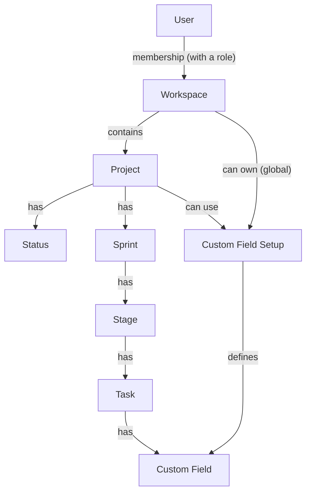

# Consilium Tempus Overview

* [What It Is](#what-it-is)
* [Concepts](#concepts)
* [Roles and Permissions](#roles-and-permissions)
* [Where to Read Next](#where-to-read-next)
* [Glossary](#glossary)

## What It Is

Consilium Tempus is a project management application.
Users organize their work inside workspaces, which contain projects, sprints and tasks,
and they collaborate with other users by inviting them to the workspaces.

This repository is the backend of the application, a RESTful Api.

## Concepts

- A **User** registers and gets a personal **Workspace** of their own.
- A **Workspace** has collaborators, through **Memberships** that carry a **Workspace Role**.
  New collaborators are invited by email, and they can accept or reject the **Invitation**.
- A workspace contains **Projects**. A project is public or private, and it has an owner.
  The ones that are private can be accessed only by their **Allowed Members**.
  Users can also add workspaces and projects to their favorites.
- A project has **Statuses**, which report how the project is doing, and **Sprints**
  (a project always has at least one). A sprint has **Stages** (at least one), and a stage has **Tasks**.
- A **Custom Field Setup** defines an extra field (i.e., a date, a number or a list of options) for the tasks.
  It is created either on a whole workspace, being available to all its projects (it is *global*), or on a single project,
  and each task gets the corresponding **Custom Field** to hold its value.
- The creation and the last update of some of the data (i.e., sprints, stages, statuses and custom field setups)
  are tracked by an **Audit**.

The aggregates and the entities behind these concepts are described in the [Domain Models](Domain.md) documentation.

## Roles and Permissions

What a user can do depends on their role inside each workspace: **View**, **Member** or **Admin**.
Some actions are also reserved to the owner of the workspace or the owner of the project,
and the private projects can be accessed only by their allowed members.
The complete matrix is described in the [Security](Security.md) documentation.

## Where to Read Next

| If you want to...                          | Read                                                         |
|--------------------------------------------|--------------------------------------------------------------|
| set up and run the application             | [README](../README.md)                                       |
| call the endpoints                         | [Api](Api.md)                                                |
| understand how the code is organized       | [Architecture](Architecture.md)                              |
| look up the classes of the domain          | [Domain Models](Domain.md)                                   |
| understand the database and its migrations | [Database](Database.md)                                      |
| configure the application                  | [Configuration](Configuration.md)                            |
| understand who can do what                 | [Security](Security.md)                                      |
| implement a new feature                    | [Feature Development Workflow](Feature-Development-Workflow.md) |
| write or run tests                         | [Testing](Testing.md)                                        |
| know how branches and commits are named    | [Git](Git.md)                                                |
| understand the workflows and the releases  | [Continuous Integration](CI.md)                              |

## Glossary

- **Workspace**: the place where users work together. It contains projects, and it has an owner.
- **Personal Workspace**: the workspace that every user gets upon registration, and of which they are the owner.
- **Collaborator**: a user that is part of a workspace.
- **Workspace Role**: what a collaborator is allowed to do inside a workspace (*View*, *Member* or *Admin*).
- **Invitation**: the request sent to a user, by email, to become a collaborator of a workspace.
- **Project**: a body of work that belongs to a workspace, owned by one of its collaborators.
- **Private Project**: a project that only its allowed members can access.
- **Allowed Member**: a collaborator that has access to a private project.
- **Favorite**: a workspace or a project that a user marked to find easily.
- **Lifecycle**: the phase of a project (i.e., upcoming, active or archived).
- **Status**: an update on how a project is doing (i.e., on track or off track).
- **Sprint**: a time-boxed period of a project, with optional start and end dates.
- **Stage**: a step inside a sprint (i.e., *To Do* or *Done*), that holds tasks.
- **Task**: a unit of work, that can be assigned, reviewed, commented and completed.
- **Custom Field Setup**: the definition of an extra field for tasks, of a certain type.
- **Custom Field**: the value of a custom field setup, on a specific task.
- **Global (Custom Field Setup)**: a setup that belongs to a workspace, and can be used by all its projects.
