# Database Diagrams

## Database Diagram

This is a full picture of the database diagram:

```mermaid
erDiagram
    User ||--o{ RefreshToken : "UserId"
    User |o--o{ Workspace : "CreatedById"
    User |o--o{ Workspace : "UpdatedById"
    User ||--o{ Workspace : "OwnerId"
    Permission ||--o{ WorkspaceRoleHasPermission : "PermissionId"
    WorkspaceRole ||--o{ WorkspaceRoleHasPermission : "WorkspaceRoleId"
    RefreshToken ||--o{ RefreshTokenHistory : "RefreshTokenId"
    User |o--o{ CustomFieldSetup : "CreatedById"
    User |o--o{ CustomFieldSetup : "UpdatedById"
    Workspace |o--o{ CustomFieldSetup : "WorkspaceId"
    CustomFieldSetup ||--|| CustomFieldSetup_Date : "Id"
    CustomFieldSetup ||--|| CustomFieldSetup_DateTime : "Id"
    CustomFieldSetup ||--|| CustomFieldSetup_Duration : "Id"
    CustomFieldSetup ||--|| CustomFieldSetup_MultiSelect : "Id"
    CustomFieldSetup ||--|| CustomFieldSetup_Number : "Id"
    CustomFieldSetup ||--|| CustomFieldSetup_People : "Id"
    CustomFieldSetup ||--|| CustomFieldSetup_SingleSelect : "Id"
    CustomFieldSetup ||--|| CustomFieldSetup_Text : "Id"
    CustomFieldSetup ||--|| CustomFieldSetup_Time : "Id"
    User ||--o{ Membership : "UserId"
    User |o--o{ Membership : "CreatedById"
    User |o--o{ Membership : "UpdatedById"
    WorkspaceRole ||--o{ Membership : "WorkspaceRoleId"
    Workspace ||--o{ Membership : "WorkspaceId"
    User |o--o{ Project : "CreatedById"
    User |o--o{ Project : "UpdatedById"
    User ||--o{ Project : "OwnerId"
    Workspace ||--o{ Project : "WorkspaceId"
    User ||--o{ UserHasFavoriteWorkspace : "UserId"
    Workspace ||--o{ UserHasFavoriteWorkspace : "WorkspaceId"
    User ||--o{ WorkspaceInvitation : "CollaboratorId"
    User ||--o{ WorkspaceInvitation : "SenderId"
    Workspace ||--o{ WorkspaceInvitation : "WorkspaceId"
    CustomFieldSetup_MultiSelect ||--o{ MultiSelectOption : "SetupId"
    CustomFieldSetup_SingleSelect ||--o{ SingleSelectOption : "SetupId"
    Project ||--o{ ProjectHasAllowedMember : "ProjectId"
    User ||--o{ ProjectHasAllowedMember : "UserId"
    Project ||--o{ ProjectHasCustomFieldSetup : "ProjectId"
    CustomFieldSetup ||--o{ ProjectHasCustomFieldSetup : "CustomFieldSetupId"
    User |o--o{ ProjectSprint : "CreatedById"
    User |o--o{ ProjectSprint : "UpdatedById"
    Project ||--o{ ProjectSprint : "ProjectId"
    User |o--o{ ProjectStatus : "CreatedById"
    User |o--o{ ProjectStatus : "UpdatedById"
    Project ||--o{ ProjectStatus : "ProjectId"
    Project ||--o{ UserHasFavoriteProject : "ProjectId"
    User ||--o{ UserHasFavoriteProject : "UserId"
    User |o--o{ ProjectStage : "CreatedById"
    User |o--o{ ProjectStage : "UpdatedById"
    ProjectSprint ||--o{ ProjectStage : "SprintId"
    ProjectStage ||--o{ ProjectTask : "StageId"
    User |o--o{ ProjectTask : "AssigneeId"
    User |o--o{ ProjectTask : "CreatedById"
    User |o--o{ ProjectTask : "UpdatedById"
    User |o--o{ ProjectTask : "ReviewerId"
    CustomFieldSetup_Date ||--o{ CustomField_Date : "SetupId"
    ProjectTask ||--o{ CustomField_Date : "ProjectTaskId"
    CustomFieldSetup_DateTime ||--o{ CustomField_DateTime : "SetupId"
    ProjectTask ||--o{ CustomField_DateTime : "ProjectTaskId"
    CustomFieldSetup_Duration ||--o{ CustomField_Duration : "SetupId"
    ProjectTask ||--o{ CustomField_Duration : "ProjectTaskId"
    CustomFieldSetup_MultiSelect ||--o{ CustomField_MultiSelect : "SetupId"
    ProjectTask ||--o{ CustomField_MultiSelect : "ProjectTaskId"
    CustomFieldSetup_Number ||--o{ CustomField_Number : "SetupId"
    ProjectTask ||--o{ CustomField_Number : "ProjectTaskId"
    CustomFieldSetup_People ||--o{ CustomField_People : "SetupId"
    ProjectTask ||--o{ CustomField_People : "ProjectTaskId"
    User |o--o{ CustomField_People : "PersonId"
    CustomFieldSetup_SingleSelect ||--o{ CustomField_SingleSelect : "SetupId"
    ProjectTask ||--o{ CustomField_SingleSelect : "ProjectTaskId"
    SingleSelectOption |o--o{ CustomField_SingleSelect : "OptionId"
    CustomFieldSetup_Text ||--o{ CustomField_Text : "SetupId"
    ProjectTask ||--o{ CustomField_Text : "ProjectTaskId"
    CustomFieldSetup_Time ||--o{ CustomField_Time : "SetupId"
    ProjectTask ||--o{ CustomField_Time : "ProjectTaskId"
    ProjectTask ||--o{ ProjectTaskComment : "TaskId"
    User ||--o{ ProjectTaskComment : "CreatedById"
    CustomField_MultiSelect ||--o{ CustomField_MultiSelectHasOption : "CustomFieldId"
    MultiSelectOption ||--o{ CustomField_MultiSelectHasOption : "OptionId"

    Permission {
        int Id PK
        nvarchar(max) Name
    }
    User {
        uniqueidentifier Id PK
        nvarchar(256) Email UK
        nvarchar(max) Password
        nvarchar(100) FirstName
        nvarchar(100) LastName
        nvarchar(50) Role "nullable"
        date DateOfBirth "nullable"
        datetime2 CreatedDateTime
        datetime2 UpdatedDateTime
    }
    WorkspaceRole {
        int Id PK
        nvarchar(max) Name
        nvarchar(max) Description
    }
    RefreshToken {
        uniqueidentifier Id PK
        datetime2 ExpiryDateTime
        bit IsInvalidated
        datetime2 CreatedDateTime
        uniqueidentifier UserId FK
    }
    Workspace {
        uniqueidentifier Id PK
        nvarchar(100) Name
        nvarchar(max) Description
        bit IsPersonal
        uniqueidentifier OwnerId FK
        datetime2 LastActivity
        uniqueidentifier CreatedById FK "nullable"
        datetime2 CreatedDateTime
        uniqueidentifier UpdatedById FK "nullable"
        datetime2 UpdatedDateTime
    }
    WorkspaceRoleHasPermission {
        int WorkspaceRoleId PK, FK
        int PermissionId PK, FK
    }
    RefreshTokenHistory {
        uniqueidentifier Id PK
        uniqueidentifier JwtId
        datetime2 CreatedDateTime
        uniqueidentifier RefreshTokenId FK
    }
    CustomFieldSetup {
        uniqueidentifier Id PK
        nvarchar(50) Name
        nvarchar(max) Description
        uniqueidentifier WorkspaceId FK "nullable"
        uniqueidentifier CreatedById FK "nullable"
        datetime2 CreatedDateTime
        uniqueidentifier UpdatedById FK "nullable"
        datetime2 UpdatedDateTime
    }
    CustomFieldSetup_Date {
        uniqueidentifier Id PK, FK
        date DefaultDate "nullable"
    }
    CustomFieldSetup_DateTime {
        uniqueidentifier Id PK, FK
        datetime2 DefaultDateTime "nullable"
    }
    CustomFieldSetup_Duration {
        uniqueidentifier Id PK, FK
        bigint DefaultDuration "nullable"
    }
    CustomFieldSetup_MultiSelect {
        uniqueidentifier Id PK, FK
    }
    CustomFieldSetup_Number {
        uniqueidentifier Id PK, FK
        nvarchar(3) CurrencyCode "nullable"
        smallint Decimals
        bit Rounding
        decimal DefaultNumber "precision 38, scale 9, nullable"
    }
    CustomFieldSetup_People {
        uniqueidentifier Id PK, FK
    }
    CustomFieldSetup_SingleSelect {
        uniqueidentifier Id PK, FK
        uniqueidentifier DefaultOptionId "nullable"
    }
    CustomFieldSetup_Text {
        uniqueidentifier Id PK, FK
        nvarchar(max) DefaultText "nullable"
    }
    CustomFieldSetup_Time {
        uniqueidentifier Id PK, FK
        time DefaultTime "nullable"
    }
    Membership {
        uniqueidentifier UserId PK, FK
        uniqueidentifier WorkspaceId PK, FK
        int WorkspaceRoleId FK
        uniqueidentifier CreatedById FK "nullable"
        datetime2 CreatedDateTime
        uniqueidentifier UpdatedById FK "nullable"
        datetime2 UpdatedDateTime
    }
    Project {
        uniqueidentifier Id PK
        nvarchar(100) Name
        nvarchar(max) Description
        bit IsPrivate
        uniqueidentifier OwnerId FK
        int Lifecycle
        datetime2 LastActivity
        uniqueidentifier WorkspaceId FK
        uniqueidentifier CreatedById FK "nullable"
        datetime2 CreatedDateTime
        uniqueidentifier UpdatedById FK "nullable"
        datetime2 UpdatedDateTime
    }
    UserHasFavoriteWorkspace {
        uniqueidentifier UserId PK, FK
        uniqueidentifier WorkspaceId PK, FK
    }
    WorkspaceInvitation {
        uniqueidentifier Id PK
        datetime2 CreatedDateTime
        uniqueidentifier SenderId FK
        uniqueidentifier CollaboratorId FK
        uniqueidentifier WorkspaceId FK
    }
    MultiSelectOption {
        uniqueidentifier Id PK
        nvarchar(50) Value
        nvarchar(7) Color
        int CustomOrderPosition
        uniqueidentifier SetupId FK
    }
    SingleSelectOption {
        uniqueidentifier Id PK
        nvarchar(50) Value
        nvarchar(7) Color
        int CustomOrderPosition
        uniqueidentifier SetupId FK
    }
    ProjectHasAllowedMember {
        uniqueidentifier ProjectId PK, FK
        uniqueidentifier UserId PK, FK
    }
    ProjectHasCustomFieldSetup {
        uniqueidentifier CustomFieldSetupId PK, FK
        uniqueidentifier ProjectId PK, FK
    }
    ProjectSprint {
        uniqueidentifier Id PK
        nvarchar(50) Name
        date StartDate "nullable"
        date EndDate "nullable"
        uniqueidentifier ProjectId FK
        uniqueidentifier CreatedById FK "nullable"
        datetime2 CreatedDateTime
        uniqueidentifier UpdatedById FK "nullable"
        datetime2 UpdatedDateTime
    }
    ProjectStatus {
        uniqueidentifier Id PK
        nvarchar(50) Title
        int Status
        nvarchar(max) Description
        uniqueidentifier ProjectId FK
        uniqueidentifier CreatedById FK "nullable"
        datetime2 CreatedDateTime
        uniqueidentifier UpdatedById FK "nullable"
        datetime2 UpdatedDateTime
    }
    UserHasFavoriteProject {
        uniqueidentifier UserId PK, FK
        uniqueidentifier ProjectId PK, FK
    }
    ProjectStage {
        uniqueidentifier Id PK
        nvarchar(50) Name
        int CustomOrderPosition
        uniqueidentifier SprintId FK
        uniqueidentifier CreatedById FK "nullable"
        datetime2 CreatedDateTime
        uniqueidentifier UpdatedById FK "nullable"
        datetime2 UpdatedDateTime
    }
    ProjectTask {
        uniqueidentifier Id PK
        nvarchar(256) Name
        nvarchar(max) Description
        int CustomOrderPosition
        bit IsCompleted
        datetime2 CompletedOn "nullable"
        uniqueidentifier AssigneeId FK "nullable"
        uniqueidentifier ReviewerId FK "nullable"
        date DueDate "nullable"
        time EstimatedDuration "nullable"
        uniqueidentifier StageId FK
        uniqueidentifier CreatedById FK "nullable"
        datetime2 CreatedDateTime
        uniqueidentifier UpdatedById FK "nullable"
        datetime2 UpdatedDateTime
    }
    CustomField_Date {
        uniqueidentifier Id PK
        uniqueidentifier ProjectTaskId FK
        date Date "nullable"
        uniqueidentifier SetupId FK
    }
    CustomField_DateTime {
        uniqueidentifier Id PK
        uniqueidentifier ProjectTaskId FK
        datetime2 DateTime "nullable"
        uniqueidentifier SetupId FK
    }
    CustomField_Duration {
        uniqueidentifier Id PK
        uniqueidentifier ProjectTaskId FK
        bigint Duration "nullable"
        uniqueidentifier SetupId FK
    }
    CustomField_MultiSelect {
        uniqueidentifier Id PK
        uniqueidentifier ProjectTaskId FK
        uniqueidentifier SetupId FK
    }
    CustomField_Number {
        uniqueidentifier Id PK
        uniqueidentifier ProjectTaskId FK
        decimal Number "precision 38, scale 9, nullable"
        uniqueidentifier SetupId FK
    }
    CustomField_People {
        uniqueidentifier Id PK
        uniqueidentifier ProjectTaskId FK
        uniqueidentifier PersonId FK "nullable"
        uniqueidentifier SetupId FK
    }
    CustomField_SingleSelect {
        uniqueidentifier Id PK
        uniqueidentifier ProjectTaskId FK
        uniqueidentifier OptionId FK "nullable"
        uniqueidentifier SetupId FK
    }
    CustomField_Text {
        uniqueidentifier Id PK
        uniqueidentifier ProjectTaskId FK
        nvarchar(max) Text "nullable"
        uniqueidentifier SetupId FK
    }
    CustomField_Time {
        uniqueidentifier Id PK
        uniqueidentifier ProjectTaskId FK
        time Time "nullable"
        uniqueidentifier SetupId FK
    }
    ProjectTaskComment {
        uniqueidentifier Id PK
        nvarchar(256) Message
        uniqueidentifier CreatedById FK
        date Date "nullable"
        time TimeSpent "nullable"
        uniqueidentifier TaskId FK
        datetime2 CreatedDateTime
        datetime2 UpdatedDateTime
    }
    CustomField_MultiSelectHasOption {
        uniqueidentifier OptionId PK, FK
        uniqueidentifier CustomFieldId PK, FK
    }
```

## Legend

The diagrams are written in *Mermaid*, and they use the following notation:

- **PK** for a primary key, **FK** for a foreign key and **UK** for a unique column
- **nullable** means that the column accepts null values (otherwise the column is required)
- the types are the ones from SQL Server (for decimals, the precision and the scale are mentioned in the comment)
- the lines between the tables are named after the foreign key column, and they start from the referenced table:
  - `||` means exactly one
  - `|o` means zero or one
  - `o{` means zero or many
  - i.e., `User ||--o{ Workspace` reads: a user has zero or many workspaces, and a workspace has exactly one user
- inside the diagrams of an aggregate or an entity, the tables that belong to others
  are shown only with their primary key, just to show the relations
