# Database Diagrams

## Custom Field Setup

### Relationships

The variants are mapped as *table per type*: the **CustomFieldSetup** table holds what they share, and each variant
(i.e., *CustomFieldSetup_Date*) holds its own columns, with the same *Id*.

- 2x **Many-to-one** relationships with the [User](../../domain/aggregates/Aggregate.User.md) aggregate
(through the **Audit**).
- **Many-to-One** (optional) relationship with the [Workspace](../../domain/aggregates/Aggregate.Workspace.md) aggregate.
- **Many-to-Many** relationship with the [Project](../../domain/aggregates/Aggregate.Project.md) aggregate.
(via the *ProjectHasCustomFieldSetup* entity)
- **One-to-Many** relationship with the [Custom Field](../../domain/entities/project-task/Entity.CustomField.md) entity.

#### Variants

##### Multi Select

- **One-to-Many** relationship with the [Multi Select Option](../../domain/entities/Entity.MultiSelectOption.md) entity.

##### Single Select

- **One-to-Many** relationship with the [Single Select Option](../../domain/entities/Entity.SingleSelectOption.md) entity.

### Diagram

For the notation used, check out the [Legend](../Database.Diagram.md#legend).

```mermaid
erDiagram
    User |o--o{ CustomFieldSetup : "CreatedById"
    User |o--o{ CustomFieldSetup : "UpdatedById"
    Workspace |o--o{ CustomFieldSetup : "WorkspaceId"
    CustomFieldSetup ||--|| CustomFieldSetup_Date : "Id"
    CustomFieldSetup ||--|| CustomFieldSetup_DateTime : "Id"
    CustomFieldSetup ||--|| CustomFieldSetup_Duration : "Id"
    CustomFieldSetup ||--|| CustomFieldSetup_MultiSelect : "Id"
    CustomFieldSetup ||--|| CustomFieldSetup_Number : "Id"
    CustomFieldSetup ||--|| CustomFieldSetup_People : "Id"
    CustomFieldSetup ||--|| CustomFieldSetup_SingleSelect : "Id"
    CustomFieldSetup ||--|| CustomFieldSetup_Text : "Id"
    CustomFieldSetup ||--|| CustomFieldSetup_Time : "Id"
    CustomFieldSetup_MultiSelect ||--o{ MultiSelectOption : "SetupId"
    CustomFieldSetup_SingleSelect ||--o{ SingleSelectOption : "SetupId"
    Project ||--o{ ProjectHasCustomFieldSetup : "ProjectId"
    CustomFieldSetup ||--o{ ProjectHasCustomFieldSetup : "CustomFieldSetupId"
    CustomFieldSetup_Date ||--o{ CustomField_Date : "SetupId"
    CustomFieldSetup_DateTime ||--o{ CustomField_DateTime : "SetupId"
    CustomFieldSetup_Duration ||--o{ CustomField_Duration : "SetupId"
    CustomFieldSetup_MultiSelect ||--o{ CustomField_MultiSelect : "SetupId"
    CustomFieldSetup_Number ||--o{ CustomField_Number : "SetupId"
    CustomFieldSetup_People ||--o{ CustomField_People : "SetupId"
    CustomFieldSetup_SingleSelect ||--o{ CustomField_SingleSelect : "SetupId"
    SingleSelectOption |o--o{ CustomField_SingleSelect : "OptionId"
    CustomFieldSetup_Text ||--o{ CustomField_Text : "SetupId"
    CustomFieldSetup_Time ||--o{ CustomField_Time : "SetupId"
    MultiSelectOption ||--o{ CustomField_MultiSelectHasOption : "OptionId"

    CustomFieldSetup_Date {
        uniqueidentifier Id PK, FK
        date DefaultDate "nullable"
    }
    CustomFieldSetup_DateTime {
        uniqueidentifier Id PK, FK
        datetime2 DefaultDateTime "nullable"
    }
    CustomFieldSetup_Duration {
        uniqueidentifier Id PK, FK
        bigint DefaultDuration "nullable"
    }
    CustomFieldSetup_MultiSelect {
        uniqueidentifier Id PK, FK
    }
    CustomFieldSetup_Number {
        uniqueidentifier Id PK, FK
        nvarchar(3) CurrencyCode "nullable"
        smallint Decimals
        bit Rounding
        decimal DefaultNumber "precision 38, scale 9, nullable"
    }
    CustomFieldSetup_People {
        uniqueidentifier Id PK, FK
    }
    CustomFieldSetup_SingleSelect {
        uniqueidentifier Id PK, FK
        uniqueidentifier DefaultOptionId "nullable"
    }
    CustomFieldSetup_Text {
        uniqueidentifier Id PK, FK
        nvarchar(max) DefaultText "nullable"
    }
    CustomFieldSetup_Time {
        uniqueidentifier Id PK, FK
        time DefaultTime "nullable"
    }
    CustomFieldSetup {
        uniqueidentifier Id PK
        nvarchar(50) Name
        nvarchar(max) Description
        uniqueidentifier WorkspaceId FK "nullable"
        uniqueidentifier CreatedById FK "nullable"
        datetime2 CreatedDateTime
        uniqueidentifier UpdatedById FK "nullable"
        datetime2 UpdatedDateTime
    }
    MultiSelectOption {
        uniqueidentifier Id PK
        nvarchar(50) Value
        nvarchar(7) Color
        int CustomOrderPosition
        uniqueidentifier SetupId FK
    }
    SingleSelectOption {
        uniqueidentifier Id PK
        nvarchar(50) Value
        nvarchar(7) Color
        int CustomOrderPosition
        uniqueidentifier SetupId FK
    }
    ProjectHasCustomFieldSetup {
        uniqueidentifier CustomFieldSetupId PK, FK
        uniqueidentifier ProjectId PK, FK
    }
    User {
        uniqueidentifier Id PK
    }
    Workspace {
        uniqueidentifier Id PK
    }
    Project {
        uniqueidentifier Id PK
    }
    CustomField_Date {
        uniqueidentifier Id PK
    }
    CustomField_DateTime {
        uniqueidentifier Id PK
    }
    CustomField_Duration {
        uniqueidentifier Id PK
    }
    CustomField_MultiSelect {
        uniqueidentifier Id PK
    }
    CustomField_Number {
        uniqueidentifier Id PK
    }
    CustomField_People {
        uniqueidentifier Id PK
    }
    CustomField_SingleSelect {
        uniqueidentifier Id PK
    }
    CustomField_Text {
        uniqueidentifier Id PK
    }
    CustomField_Time {
        uniqueidentifier Id PK
    }
    CustomField_MultiSelectHasOption {
        uniqueidentifier OptionId PK, FK
        uniqueidentifier CustomFieldId PK, FK
    }
```

