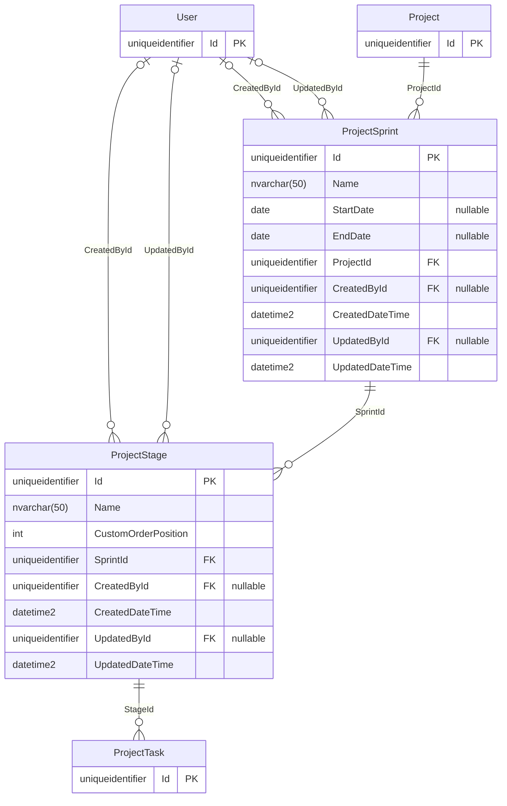

# Database Diagrams

## Project Sprint

### Relationships

- **Many-to-one** relationship with the [Project](../../domain/aggregates/Aggregate.Project.md) aggregate.
- **One-to-many** relationship with the [Project Stage](../../domain/entities/project-sprint/Entity.ProjectStage.md) entity.
- 2x **Many-to-one** relationships with the [User](../../domain/aggregates/Aggregate.User.md) aggregate
(through the **Audit**).

### Owned Entities Relationships

#### Project Stage

- **One-to-many** relationship with the [Project Task](../../domain/aggregates/Aggregate.ProjectTask.md) aggregate.
- 2x **Many-to-one** relationships with the [User](../../domain/aggregates/Aggregate.User.md) aggregate
(through the **Audit**).

### Diagram

For the notation used, check out the [Legend](../Database.Diagram.md#legend).

