# Database Diagrams

## User

### Relationships

- **Many-to-many** relationship with the [Workspace](../../domain/aggregates/Aggregate.Workspace.md) aggregate
(through the **Many-to-one** relationship with the [Membership](../../domain/entities/Entity.Membership.md) entity).
- **Many-to-many** relationship with the [Workspace](../../domain/aggregates/Aggregate.Workspace.md) aggregate
(through the **UserHasFavoriteWorkspace**).
- 2x **One-to-Many** relationship with the [Workspace Invitation](../../domain/entities/workspace/Entity.WorkspaceInvitation.md) entity.
- **Many-to-many** relationship with the [Project](../../domain/aggregates/Aggregate.Project.md) aggregate
(through the **UserHasFavoriteProject**).
- **Many-to-many** relationship with the [Project](../../domain/aggregates/Aggregate.Project.md) aggregate
  (through the **ProjectHasAllowedMember**).
- **One-to-many** relationship with the [Custom Field](../../domain/entities/project-task/Entity.CustomField.md) entity
(the *People* variant).
- **One-to-many** relationship with the [Refresh Token](../../domain/entities/Entity.RefreshToken.md) entity.
- 2x **One-to-many** relationship with the [Custom Field Setup](../../domain/aggregates/Aggregate.CustomFieldSetup.md) aggregate
(through the **Audit**).
- 2x **One-to-many** relationship with the [Membership](../../domain/entities/Entity.Membership.md) entity
(through the **Audit**).
- 2x **One-to-many** relationship with the [Project](../../domain/aggregates/Aggregate.Project.md) aggregate
(through the **Audit**).
- 2x **One-to-many** relationship with the [Project Sprint](../../domain/aggregates/Aggregate.ProjectSprint.md) aggregate
(through the **Audit**).
- 2x **One-to-many** relationship with the [Project Stage](../../domain/entities/project-sprint/Entity.ProjectStage.md) entity
(through the **Audit**).
- 2x **One-to-many** relationship with the [Project Status](../../domain/entities/project/Entity.ProjectStatus.md) entity
(through the **Audit**).
- 2x **One-to-many** relationship with the [Project Task](../../domain/aggregates/Aggregate.ProjectTask.md) aggregate
(through the **Audit**).
- 2x **One-to-many** relationship with the [Workspace](../../domain/aggregates/Aggregate.Workspace.md) aggregate
(through the **Audit**).
- **One-to-many** relationship with the [Workspace](../../domain/aggregates/Aggregate.Workspace.md) aggregate.
- **One-to-many** relationship with the [Project](../../domain/aggregates/Aggregate.Project.md) aggregate.
- 2x **One-to-many** relationships with the [Project Task](../../domain/aggregates/Aggregate.ProjectTask.md) aggregate.
- **One-to-many** relationship with the [Project Task Comment](../../domain/entities/project-task/Entity.ProjectTaskComment.md) entity.

### Diagram

For the notation used, check out the [Legend](../Database.Diagram.md#legend).

```mermaid
erDiagram
    User ||--o{ RefreshToken : "UserId"
    RefreshToken ||--o{ RefreshTokenHistory : "RefreshTokenId"
    User ||--o{ Membership : "UserId"
    User |o--o{ Membership : "CreatedById"
    User |o--o{ Membership : "UpdatedById"
    WorkspaceRole ||--o{ Membership : "WorkspaceRoleId"
    Workspace ||--o{ Membership : "WorkspaceId"
    User ||--o{ UserHasFavoriteWorkspace : "UserId"
    Workspace ||--o{ UserHasFavoriteWorkspace : "WorkspaceId"
    Project ||--o{ UserHasFavoriteProject : "ProjectId"
    User ||--o{ UserHasFavoriteProject : "UserId"
    User |o--o{ CustomFieldSetup : "CreatedById"
    User |o--o{ CustomFieldSetup : "UpdatedById"
    User |o--o{ ProjectSprint : "CreatedById"
    User |o--o{ ProjectSprint : "UpdatedById"
    User |o--o{ ProjectStatus : "CreatedById"
    User |o--o{ ProjectStatus : "UpdatedById"
    User |o--o{ ProjectStage : "CreatedById"
    User |o--o{ ProjectStage : "UpdatedById"
    User |o--o{ Workspace : "CreatedById"
    User |o--o{ Workspace : "UpdatedById"
    User ||--o{ Workspace : "OwnerId"
    User |o--o{ Project : "CreatedById"
    User |o--o{ Project : "UpdatedById"
    User ||--o{ Project : "OwnerId"
    User ||--o{ WorkspaceInvitation : "CollaboratorId"
    User ||--o{ WorkspaceInvitation : "SenderId"
    User ||--o{ ProjectHasAllowedMember : "UserId"
    User |o--o{ ProjectTask : "AssigneeId"
    User |o--o{ ProjectTask : "CreatedById"
    User |o--o{ ProjectTask : "UpdatedById"
    User |o--o{ ProjectTask : "ReviewerId"
    User |o--o{ CustomField_People : "PersonId"
    User ||--o{ ProjectTaskComment : "CreatedById"

    User {
        uniqueidentifier Id PK
        nvarchar(256) Email UK
        nvarchar(max) Password
        nvarchar(100) FirstName
        nvarchar(100) LastName
        nvarchar(50) Role "nullable"
        date DateOfBirth "nullable"
        datetime2 CreatedDateTime
        datetime2 UpdatedDateTime
    }
    RefreshToken {
        uniqueidentifier Id PK
        datetime2 ExpiryDateTime
        bit IsInvalidated
        datetime2 CreatedDateTime
        uniqueidentifier UserId FK
    }
    RefreshTokenHistory {
        uniqueidentifier Id PK
        uniqueidentifier JwtId
        datetime2 CreatedDateTime
        uniqueidentifier RefreshTokenId FK
    }
    Membership {
        uniqueidentifier UserId PK, FK
        uniqueidentifier WorkspaceId PK, FK
        int WorkspaceRoleId FK
        uniqueidentifier CreatedById FK "nullable"
        datetime2 CreatedDateTime
        uniqueidentifier UpdatedById FK "nullable"
        datetime2 UpdatedDateTime
    }
    UserHasFavoriteWorkspace {
        uniqueidentifier UserId PK, FK
        uniqueidentifier WorkspaceId PK, FK
    }
    UserHasFavoriteProject {
        uniqueidentifier UserId PK, FK
        uniqueidentifier ProjectId PK, FK
    }
    WorkspaceRole {
        int Id PK
    }
    CustomFieldSetup {
        uniqueidentifier Id PK
    }
    ProjectSprint {
        uniqueidentifier Id PK
    }
    ProjectStatus {
        uniqueidentifier Id PK
    }
    ProjectStage {
        uniqueidentifier Id PK
    }
    Workspace {
        uniqueidentifier Id PK
    }
    Project {
        uniqueidentifier Id PK
    }
    WorkspaceInvitation {
        uniqueidentifier Id PK
    }
    ProjectHasAllowedMember {
        uniqueidentifier ProjectId PK, FK
        uniqueidentifier UserId PK, FK
    }
    ProjectTask {
        uniqueidentifier Id PK
    }
    CustomField_People {
        uniqueidentifier Id PK
    }
    ProjectTaskComment {
        uniqueidentifier Id PK
    }
```

