# Database Diagrams

## Audit

### Relationships

- 2x **Many-to-One** relationships with the [User](../../domain/aggregates/Aggregate.User.md) aggregate.
- **One-to-many** relationship with the [Project Status](../../domain/entities/project/Entity.ProjectStatus.md) entity.
- **One-to-one** relationship with the [Project Sprint](../../domain/aggregates/Aggregate.ProjectSprint.md) aggregate.
- **One-to-one** relationship with the [Project Stage](../../domain/entities/project-sprint/Entity.ProjectStage.md) entity.
- **One-to-one** relationship with the [Custom Field Setup](../../domain/aggregates/Aggregate.CustomFieldSetup.md) aggregate.

### Diagram

For the notation used, check out the [Legend](../Database.Diagram.md#legend).

```mermaid
erDiagram
    User |o--o{ Audit : "CreatedById"
    User |o--o{ Audit : "UpdatedById"
    Audit ||--o| CustomFieldSetup_Date : "AuditId"
    Audit ||--o| CustomFieldSetup_DateTime : "AuditId"
    Audit ||--o| CustomFieldSetup_Duration : "AuditId"
    Audit ||--o| CustomFieldSetup_MultiSelect : "AuditId"
    Audit ||--o| CustomFieldSetup_Number : "AuditId"
    Audit ||--o| CustomFieldSetup_People : "AuditId"
    Audit ||--o| CustomFieldSetup_SingleSelect : "AuditId"
    Audit ||--o| CustomFieldSetup_Text : "AuditId"
    Audit ||--o| CustomFieldSetup_Time : "AuditId"
    Audit ||--o| ProjectSprint : "AuditId"
    Audit ||--o{ ProjectStatus : "AuditId"
    Audit ||--o| ProjectStage : "AuditId"

    Audit {
        uniqueidentifier Id PK
        uniqueidentifier CreatedById FK "nullable"
        datetime2 CreatedDateTime
        uniqueidentifier UpdatedById FK "nullable"
        datetime2 UpdatedDateTime
    }
    User {
        uniqueidentifier Id PK
    }
    CustomFieldSetup_Date {
        uniqueidentifier Id PK
    }
    CustomFieldSetup_DateTime {
        uniqueidentifier Id PK
    }
    CustomFieldSetup_Duration {
        uniqueidentifier Id PK
    }
    CustomFieldSetup_MultiSelect {
        uniqueidentifier Id PK
    }
    CustomFieldSetup_Number {
        uniqueidentifier Id PK
    }
    CustomFieldSetup_People {
        uniqueidentifier Id PK
    }
    CustomFieldSetup_SingleSelect {
        uniqueidentifier Id PK
    }
    CustomFieldSetup_Text {
        uniqueidentifier Id PK
    }
    CustomFieldSetup_Time {
        uniqueidentifier Id PK
    }
    ProjectSprint {
        uniqueidentifier Id PK
    }
    ProjectStatus {
        uniqueidentifier Id PK
    }
    ProjectStage {
        uniqueidentifier Id PK
    }
```

