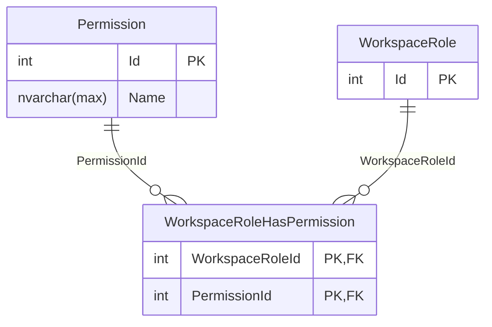

# Database Diagrams

## Permission

### Relationships

- **Many-to-many** relationship with the [Workspace Role](../../domain/entities/Entity.WorkspaceRole.md) entity.

### Diagram

For the notation used, check out the [Legend](../Database.Diagram.md#legend).

