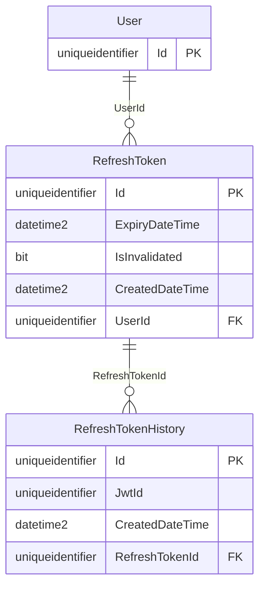

# Database Diagrams

## Refresh Token

### Relationships

- **Many-to-One** relationship with the [User](../../domain/aggregates/Aggregate.User.md) aggregate.
- **One-to-Many** relationship with the [Refresh Token History](../../domain/entities/refresh-token/Entity.RefreshTokenHistory.md) entity.

### Diagram

For the notation used, check out the [Legend](../Database.Diagram.md#legend).

