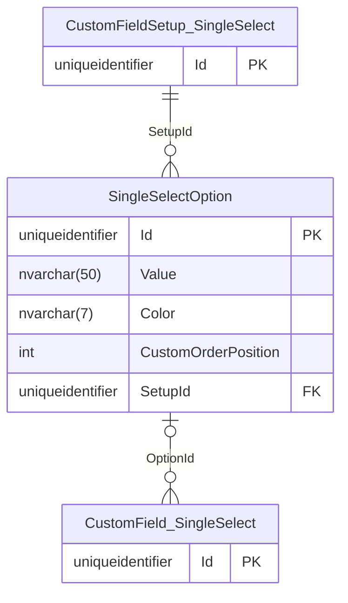

# Database Diagrams

## Single Select Option

### Relationships

- **One-to-Many** relationship with the [Custom Field Single Select](../../domain/entities/project-task/Entity.CustomField.md) entity.
- **Many-to-One** relationship with the [Custom Field Setup Single Select](../../domain/aggregates/Aggregate.CustomFieldSetup.md) aggregate.

### Diagram

